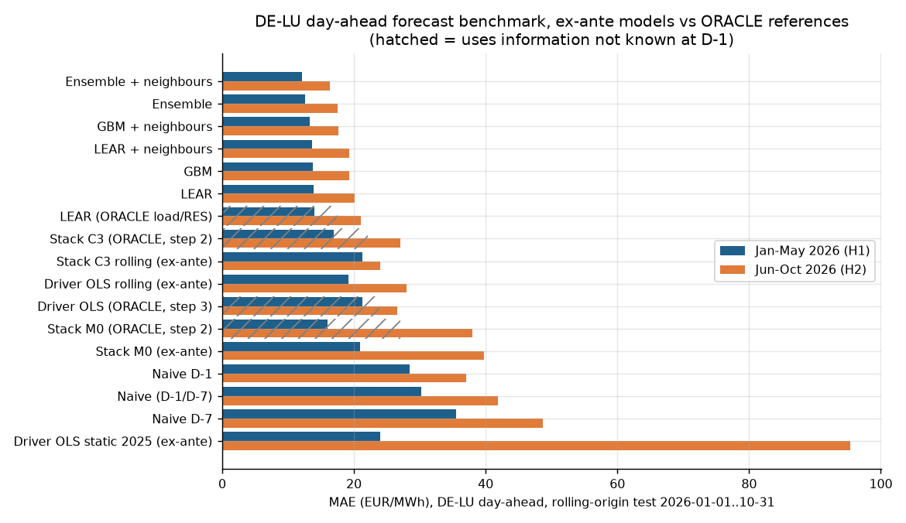
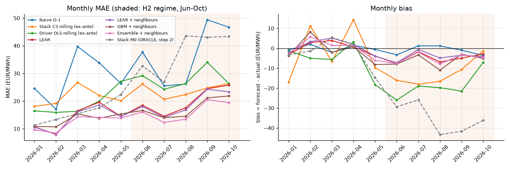
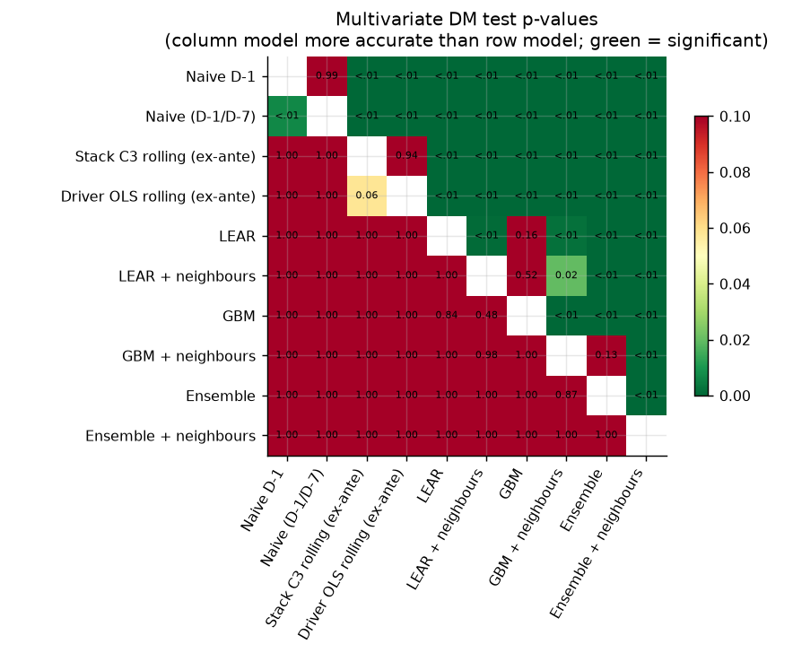

# epm-price-forecast-benchmark

**Step 5 of the [European Power Market Lab](https://github.com/DataWithSyed/eu-power-market-lab).** A common rolling-origin backtest harness for DE-LU day-ahead price forecasts on the lab panel. It compares naive benchmarks, the step-2 merit-order stack, the step-3 driver regression, a LEAR-style regularised regression and a gradient-boosting model. All of them use **strictly ex-ante** information at day-ahead gate closure. The test runs from 2026-01-01 to 2026-10-31 (304 days × 24 h) and gives special attention to the Jun–Oct 2026 regime in which the fundamental stack under-prices.

> Related, not replaced: [`de-day-ahead-price-forecasting`](https://github.com/DataWithSyed/de-day-ahead-price-forecasting) is an earlier single-repo study (LEAR/GBM/ensemble, BESS value of forecasts, probabilistic fans) on its own data. This repo asks a different question. On the **shared lab panel**, how do the lab's own fundamental models (steps 2–3) compare with statistical forecasters under the same information set, and what survives the H2-2026 regime shift?

## Problem

Steps 2–4 found that a transparent merit-order stack explains DE-LU prices well in 2025 but under-prices **Jun–Oct 2026** by about 35 €/MWh. Neither carbon (step 3) nor capacity tightness (step 4) explains that gap. Step 5 asks the following:

1. If every model is restricted to the information available at **D-1 12:00 Europe/Berlin**, which forecast is most accurate?
2. Does the fundamental view (stack, driver OLS) add anything over statistical models?
3. How much accuracy is lost in H2 2026, and which models degrade least?
4. Do neighbour-zone load/RES forecasts and lagged cross-border trade help? This follows the step-4 lead that DE moved from net importer to net exporter in Aug–Oct 2026.

## Method

**Data.** The step-2 hourly panel is reused unchanged (`data/processed/hourly_panel.csv`, byte-identical to `epm-merit-order-model`; 16,056 h, 2025-01 → 2026-10). The step-2 M0/C3 model prices are shipped as ORACLE references. The repo adds one new input, **real TSO day-ahead forecasts** of load, solar, wind onshore and wind offshore for DE and eight neighbours (FR, NL, BE, AT, PL, CZ, DK, CH), taken from the Energy-Charts `public_power_forecast` API (CC BY 4.0). Because real forecasts are used, **no actual-as-perfect-forecast proxy** is needed for residual load. Monthly fuels come from the World Bank Pink Sheet and are lagged to their publication date. EUA prices are the DEHSt monthly auction averages, also lagged.

**Information set** (full register in [`docs/assumptions.md`](docs/assumptions.md)):

- DA prices up to D-1, and day-D TSO forecasts. The publication vintage is ASSUMED to be before gate closure.
- Realised generation and trade only up to D-2.
- Monthly fuel and EUA values only once they are published (ASSUMED from the 4th of the following month).
- Anything that breaks these rules is labelled **ORACLE**. ORACLE models are shown for reference and are kept out of the ex-ante ranking.

**Models** (all re-estimated in a rolling origin and never tuned on the test window):

| Key | Model | Re-estimation |
|---|---|---|
| `naive_d1`, `naive_w1`, `naive_lago` | Same hour D-1; same hour D-7 (seasonal naive, weekly); the D-1/D-7 hybrid of Lago et al. 2021 | – |
| `stack_M0_exante` | Step-2 isolated-zone merit-order stack (5 techs × 10 ASSUMED efficiency bands, IPCC CO₂ factors) driven by **forecast** residual load minus must-run RES (mean of D-8..D-2) and lagged fuels/EUA | static fleet |
| `stack_C3_exante` | `a + b·M0_exante` (step-2 C3 idea) | daily, trailing 90 d |
| `ols_drivers_exante` | Step-3 driver OLS: price ~ residual-load forecast + gas + coal + EUA | static fit on 2025 |
| `ols_drivers_rolling` | Same regressors | daily, trailing 364 d |
| `lear` | LEAR-style: 24 hour-specific L1-regularised regressions (LassoLarsIC/AIC, the LEAR choice) on asinh(median/MAD)-scaled prices. Inputs: prices D-1/2/3/7, load and RES forecasts D and D-1, lagged fuels, day-of-week | daily, trailing 364 d |
| `gbm` | One `HistGradientBoostingRegressor` over all hours (fixed hyper-parameters). Inputs: price lags and D-1 summary, load/RES/RL forecasts, fuels, hour, day-of-week | every 7 d, trailing 364 d |
| `ens` | Mean of LEAR and GBM | – |
| `*_nb` | Adds neighbour residual-load and RES forecasts for D plus realised DE net trade at D-2 | as above |

**Scoring.** MAE, RMSE, sMAPE, bias and rMAE (vs the Lago naive) are computed per month, for the full test, and for H1 (Jan–May) vs H2 (Jun–Oct) 2026. Significance uses the multivariate Diebold–Mariano test (Lago et al. 2021). The daily loss is the L1 norm over 24 h, and p-values are one-sided.

## Key results (measured, `results/`)

Realised DE-LU DA price: H1 mean 96.5 €/MWh (std 55.9), H2 mean 131.3 (std 77.8); 6.5 % negative hours overall.

| Model (ex-ante unless marked) | MAE full | MAE H1 | MAE H2 | RMSE full | sMAPE % | bias H2 |
|---|---|---|---|---|---|---|
| Naive D-1 | 32.78 | 28.50 | 37.01 | 50.84 | 47.8 | −1.06 |
| Seasonal naive D-7 | 42.17 | 35.53 | 48.72 | 64.20 | 55.4 | −4.61 |
| Naive D-1/D-7 (Lago) | 36.07 | 30.17 | 41.89 | 56.45 | 49.9 | −0.96 |
| Stack M0 | 30.42 | 20.95 | 39.77 | 44.83 | 55.8 | −37.77 |
| **Stack C3 rolling (best baseline)** | **22.67** | 21.27 | **24.04** | 36.07 | 41.4 | −12.50 |
| Driver OLS, static 2025 | 59.91 | 24.04 | 95.30 | 80.47 | 82.0 | −95.28 |
| Driver OLS, rolling | 23.63 | 19.21 | 27.98 | 35.47 | 37.6 | −18.58 |
| LEAR | 17.07 | 13.93 | 20.16 | 29.50 | 29.4 | −4.74 |
| LEAR + neighbours | 16.48 | 13.64 | 19.30 | 27.80 | 29.4 | −4.04 |
| GBM | 16.51 | 13.71 | 19.27 | 27.44 | 29.8 | −7.27 |
| GBM + neighbours | 15.46 | 13.26 | 17.62 | 25.97 | 28.6 | −6.05 |
| Ensemble | 15.10 | 12.65 | 17.52 | 25.78 | 27.9 | −6.01 |
| **Ensemble + neighbours (best)** | **14.25** | **12.14** | **16.33** | **24.34** | **27.3** | −5.04 |
| *ORACLE* stack M0 (step 2, realised RL) | 27.06 | 16.04 | 37.93 | 42.47 | 56.5 | −35.26 |
| *ORACLE* stack C3 (step 2) | 22.07 | 16.99 | 27.08 | 36.41 | 43.4 | −12.63 |
| *ORACLE* driver OLS (step 3) | 23.93 | 21.29 | 26.54 | 36.05 | 37.0 | −8.14 |
| *ORACLE* LEAR (realised load/RES) | 17.56 | 14.02 | 21.05 | 28.57 | 30.4 | −5.87 |



Findings:

1. **Statistical models win clearly.** The best ex-ante model, the LEAR+GBM ensemble with neighbour features, has MAE 14.25 €/MWh, rMAE 0.40 vs the Lago naive. That is **8.4 €/MWh (37 %) better than the best fundamental baseline**, the rolling stack C3 (22.67). The DM test of the ensemble vs C3 gives a statistic of 16.5 (p < 1e-4). The improvement is also significant in H1 and H2 separately. Every LEAR/GBM variant beats C3 in both halves (`results/dm_vs_best_baseline.csv`).
2. **The fundamental stack needs rolling recalibration to be useful.** Uncalibrated M0 is worse than naive D-1 in H2 (39.8 vs 37.0) because it inherits the −38 €/MWh H2 bias. A daily 90-day re-scaling (C3) cuts this to 24.0, and C3 is the most stable baseline across regimes (H1 21.3 → H2 24.0).
3. **A static driver regression breaks ex-ante. This is an honest negative result.** Fitted on 2025 with ex-ante lagged fuels, the step-3 OLS has an H2 MAE of 95.3 and a bias of −95. In 2025 the fuels barely move, so the gas and EUA coefficients are poorly identified (gas −1.2 €/MWh per €/MWh_th). Gas then leaves the 2025 range of 28–50 €/MWh_th and reaches 75–87 in Sep–Oct 2026, and that extrapolation fails. Re-fitting daily on the trailing year repairs it (23.6), but it still trails C3 overall (DM p = 0.06). It does beat C3 in H1 (p = 0.008) and loses in H2.
4. **Every model degrades in H2.** MAE rises 33–45 % from H1 to H2 for LEAR/GBM/ensemble (ensemble+nb 12.1 → 16.3). Their H2 bias stays at −4 to −7 €/MWh, against −38 for the stack. Price-lag models absorb the level shift within days. September and October 2026 are the hardest months for all models (ensemble+nb MAE 20.6 / 19.4).
5. **Neighbour and trade features help, mostly in H2.** Adding neighbour residual-load/RES forecasts and D-2 trade improves the ensemble from 15.10 to 14.25 (DM p < 1e-4), GBM from 16.51 to 15.46 (p < 1e-4) and LEAR from 17.07 to 16.48 (p = 0.0009). In H1 the gain is small and not significant for LEAR (p = 0.12) or GBM (p = 0.057). In H2 it is clear: ensemble 17.52 → 16.33 and GBM 19.27 → 17.62 (both p < 1e-4). This fits the step-4 observation that coupling and trade mattered more in Jun–Oct 2026, but it is a forecasting gain, not a causal explanation of the stack gap.
6. **Real TSO forecasts were enough.** LEAR with realised day-D load/RES (ORACLE, 17.56) was *not* better than LEAR with the TSO day-ahead forecasts (17.07). The day-ahead residual-load forecast error itself is MAE 2.9 GW (bias +0.5 GW) on the test window.




## How to run

```bash
pip install -r requirements.txt
python -m pytest -q                       # 12 tests
python scripts/run_benchmark.py --refresh # ~25 min single-core (LEAR refit daily); writes results/
python scripts/make_figures.py            # figures/
# optional: re-download the raw Energy-Charts forecasts (git-ignored) and rebuild the forecast panel
python scripts/build_forecast_panel.py --fetch
```

Outputs in `results/` include `metrics.csv` (MAE/RMSE/sMAPE/bias/rMAE by period), `mae_by_month.csv`, `bias_by_month.csv`, `mae_by_hour.csv`, `dm_pvalues_*.csv`, `dm_vs_best_baseline.csv`, `neighbour_coupling_dm.csv`, `lear_nonzero_share_by_block.csv`, `forecasts_test.csv.gz` (all hourly forecasts) and `summary.json`.

## Assumptions

See [`docs/assumptions.md`](docs/assumptions.md). The main ones:

- The publication vintage of the TSO day-ahead forecasts is ASSUMED to be before gate closure. Energy-Charts does not publish timestamps.
- Monthly fuel and EUA values are ASSUMED usable from the 4th of the next month.
- The 2025 EUA value is the flat annual DEHSt VWAP (a proxy). The October 2026 EUA value is the Q3 VWAP carried forward.
- The stack fleet, efficiencies and must-run are the step-2 ASSUMED values. The must-run RES supply is a D-8..D-2 same-hour mean.
- DST is handled as follows: the missing spring hour is interpolated and the duplicated autumn hour is averaged, for actuals and forecasts alike.

## Limitations

- These are point forecasts only; probabilistic forecasts are in `de-day-ahead-price-forecasting`. There is one test window of 10 months and no hyper-parameter search. GBM settings are fixed and untuned, which favours neither model.
- Hours are treated as hourly means of the native 15-min DE-LU MTU (since Oct 2025). Intra-hour shape is ignored.
- The neighbour features are aggregates of national TSO forecasts with a few causal gap fills. AT/CH/CZ publish no offshore series, which is treated as 0. No neighbour prices are used.
- The DM tests are not corrected for multiple comparisons. Many p-values are below 1e-4, but borderline ones (C3 vs rolling OLS, p = 0.06) should be read with that in mind.
- The stack model remains an isolated-zone, ASSUMED-efficiency model. Its H2 under-pricing is diagnosed in steps 2–4 and is not solved here.

## Data and licences

- Energy-Charts.info (Fraunhofer ISE) public power, load, trade and day-ahead forecasts: CC BY 4.0. DE-LU day-ahead price: Bundesnetzagentur | SMARD.de, CC BY 4.0.
- World Bank Commodity Price Data (Pink Sheet): CC BY 4.0. ECB reference rates. DEHSt auction reports (official public figures).
- Raw API JSON is git-ignored; the processed panels in `data/processed/` are redistributed with attribution.

## References (DOIs checked on Crossref, 2026-11-15)

- Lago, Marcjasz, De Schutter & Weron (2021). Forecasting day-ahead electricity prices: a review of state-of-the-art algorithms, best practices and an open-access benchmark. *Applied Energy* 293. [10.1016/j.apenergy.2021.116983](https://doi.org/10.1016/j.apenergy.2021.116983)
- Uniejewski, Weron & Ziel (2018). Variance stabilizing transformations for electricity spot price forecasting. *IEEE Trans. Power Systems*. [10.1109/TPWRS.2017.2734563](https://doi.org/10.1109/TPWRS.2017.2734563)
- Diebold & Mariano (1995). Comparing predictive accuracy. *J. Business & Economic Statistics*. [10.1080/07350015.1995.10524599](https://doi.org/10.1080/07350015.1995.10524599)

## Series

Part of the [European Power Market Lab](https://github.com/DataWithSyed/eu-power-market-lab). Previous step: [`epm-capacity-adequacy`](https://github.com/DataWithSyed/epm-capacity-adequacy). Next step: `epm-bess-value-from-scenarios`.

MIT licence (code). Data keep their own licences.
